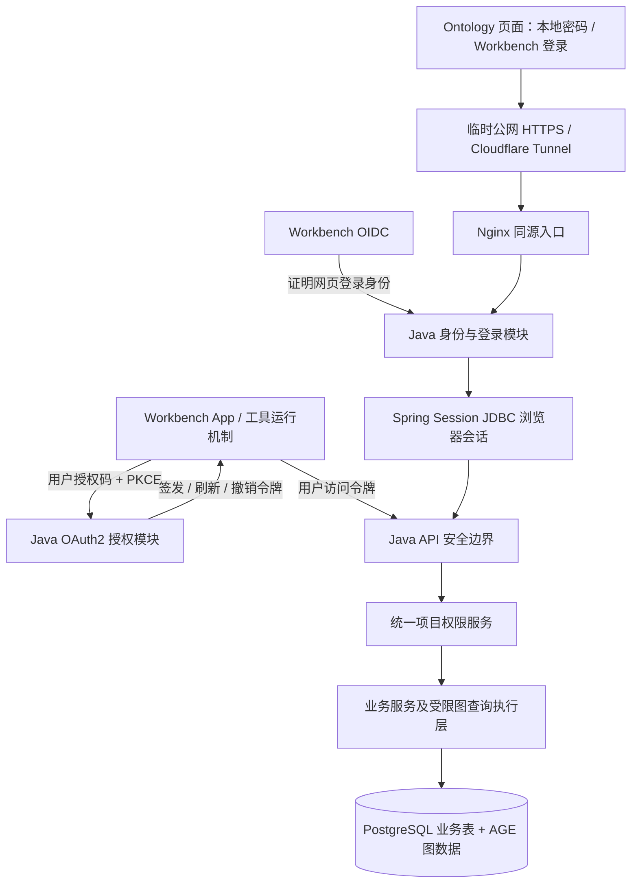

# Ontology 独立 App 多用户方案总稿 v1.0

日期：2026-10-20。范围：Mac 本机开发测试、Docker PostgreSQL + AGE、临时公网入口与 Workbench App 接入。

本稿汇总已确认的 15 项功能规则与 T01—T29 技术决策。它是后续实现、测试和验收的依据，不表示这些功能已经落地。原始确认依据见[功能记录](方案讨论记录.md)与[技术记录](技术方案讨论记录.md)。

## 1. 当前状态与本轮产物

- 用户已反馈现有 OIDC 登录能返回项目页，Workbench App 能打开 Ontology。这证明旧接入流程可用，不证明多用户隔离或新版 Agent 授权已完成。
- 旧链路由 Nginx、Python 接入服务、Java 业务服务及 PostgreSQL/AGE 构成。新设计把身份、会话、授权与项目权限统一迁入 Java。
- 2026-10-20 只读核对：Java 父项目为 Spring Boot 3.3.10；业务源码未检出新的 `SecurityFilterChain`、内部用户及成员模型标识。当前数据库 `ontology`、`public` 中未发现名称匹配用户、身份、成员、会话、授权或 OAuth 客户端的新表。
- 当前自由 Cypher 入口仍把输入交给拼接 SQL 的存储路径；目标中的只读与当前图谱隔离尚未实现、验证。
- 已准备 7 个账号、2 个测试项目的私有初始化输入。该文件状态为 `not_applied`，不自动执行，当前 Java 尚无消费它的初始化模块。
- 本轮未执行数据库结构迁移、用户建号、账号密码重置、服务切换或服务器部署。

## 2. 目标架构与职责

| 部分 | 职责 |
| --- | --- |
| 前端 | 登录、项目与图谱交互、展示当前能力；不自行决定用户身份或访问权 |
| App 包 | 页面入口、OAuth 配置与 Agent 工具声明；不实现业务数据隔离 |
| Nginx | 同源静态资源与可信反向代理；公网 HTTPS 经临时隧道进入，不承担最终业务身份判断 |
| Spring Security | 身份验证、请求身份恢复、CSRF 及通用请求安全 |
| Spring Session JDBC | 将浏览器会话持久化到现有 PostgreSQL |
| Spring 官方授权服务器组件 | 授权码、PKCE、客户端校验、令牌签发、刷新及撤销 |
| 内部用户模块 | 账号状态、密码、外部身份关联、安全版本与受控初始化 |
| 项目权限服务 | 根据当前成员关系、系统权限和操作能力统一授权 |
| 业务/存储层 | 校验真实资源归属、受限查询、事务写入及审计 |

组件集成到同一 Java 应用。当前不新增 Redis、独立认证服务或独立密钥管理服务。具体兼容版本另经工程验证锁定。

## 3. 用户、两种登录与身份绑定

Ontology 内部用户编号 `user_id` 是账号、会话和项目权限的关联依据。编号具体格式属于实施选型，尚未单独锁定。

- 本地密码：由系统管理员邀请开通，不开放公开自助注册。
- Workbench 登录：OIDC 授权码 + PKCE，由 Java 换取并验证身份结果。通过受信 JWKS 验签，同时验证 issuer、audience、有效期、nonce 等协议条件。
- 外部身份按已验证的 `(iss, sub)` 唯一关联内部用户；邮箱和昵称用于资料，不作为自动合并依据。
- Workbench 首次登录验证成功后可创建普通内部用户，不自动加入任何已有项目。
- 两种登录方式经双方身份验证后显式绑定到同一内部用户。已关联其他内部用户的身份冲突不得通过猜测邮箱或自动移动项目解决，具体冲突处理须在实现前列清。
- 本地密码使用 Spring Security 的 Argon2id 编码；数据库保存带盐的哈希记录，参数在目标环境测量后确定。

账号激活、密码重置由管理员发起，使用绑定账号及用途的短期单次随机链接，服务器仅保存摘要。打开链接不消费凭证，成功设置密码时原子消费；申请重置本身不改变原密码或会话，成功重置后执行全量撤销并重新登录。本机阶段可通过核实身份的人工渠道交付，不假定已部署邮件服务。

## 4. 浏览器会话与嵌入

| 参数 | 已确认值 |
| --- | --- |
| 会话持有方 | Ontology Java 后端 |
| 持久化 | Spring Session JDBC + PostgreSQL |
| 闲置期限 | 30 分钟 |
| 单次最长 | 本次登录建立后 8 小时 |
| Cookie | 随机会话编号；Secure、HttpOnly、限定 Ontology 主机，Path=/ |
| 跨站内嵌 | SameSite=None，配合 CSRF 和请求来源校验 |

有效使用请求可以延长闲置期限，纯后台轮询/刷新不能无限保持网页登录；请求分类及长时间本地编辑的到期提示需测试。ID Token 的 exp 用于登录时接受凭证，不直接充当已建立会话的寿命。

Cookie 认证的 POST/PUT/PATCH/DELETE 等请求执行 CSRF 校验，包括采用 POST 的查询、本地登录和退出；读取方法不承载业务状态修改。前端从同源接口获取校验码，登录/退出后按框架生命周期重新获取，并配合来源检查。OIDC/OAuth 协议端点按各自协议配置，不把整片路径无条件放行。

内嵌页面仍运行在 Ontology 来源。浏览器禁止第三方 Cookie 时，提供新窗口独立使用入口；不假定 SameSite=None 可绕过浏览器限制。OIDC 跳转与业务会话的 Cookie 兼容性需联合验证。

## 5. 项目与数据权限

项目默认私有，启用用户均可创建项目并成为 OWNER。成员接受站内邀请后才获得权限；首版只邀请已注册 Ontology 用户。账号开通邀请与项目邀请是两件事。

| 能力 | OWNER | 项目 ADMIN | EDITOR | VIEWER |
| --- | --- | --- | --- | --- |
| 查看及导出有权访问的数据 | 是 | 是 | 是 | 是 |
| 新建/修改图谱及维护图内容、导入 | 是 | 是 | 是 | 否 |
| 删除整张图谱 | 是 | 是 | 否 | 否 |
| 管理普通成员及邀请 | 是 | 是 | 否 | 否 |
| 转移所有权、删除项目 | 是 | 否 | 否 | 否 |

系统管理员具备全局项目查看及管理权限；这不是项目 ADMIN 或数据库超级用户身份。通过 App 调用时仍须有效授权和对应 scope。

访问链路：验证用户 → 从持久化记录查明资源所属图谱/项目 → 读取当前角色及系统权限 → 判断具体能力 → 执行受范围约束的数据访问。

- 网页与 Agent 共用 Java 项目权限服务，页面按钮仅表达可用操作。
- 成员关系及系统权限以数据库当前状态为准，不把角色快照固定八小时。
- 列表/统计先限定可见范围，再分页、汇总。
- 节点、关系、图谱及请求中的父资源必须匹配，混合批量 ID 同样检查。
- 成员离开后仅失去其成员权限，已创建的数据留在项目中；其他独立系统权限仍单独判断。
- 项目所有权变更等多记录修改必须保持整体事务与并发一致性。

## 6. 保留自由语句查询，但只读且限定当前图谱

按用户明确要求，保留现有 Cypher 输入面板，不改成仅能选择固定查询类型，也不默认停用面板。

“在哪个图谱输入，就只查询哪个图谱”由服务器实现：查明真实图谱记录及项目授权，再确定实际图库；不信任客户端自报的图库名称、归属或类型。

所有角色在该输入框都只允许查询。增删改走业务功能并按项目角色授权。系统管理员也不通过此入口获得任意写语句权限。

**尚须工程验证：**修复当前 SQL 文本拼接边界；证明自由输入不能越过当前图库或只读约束；限制可调用能力、执行时间和结果规模。只读账号、框架 readOnly 提示、关键词过滤或简单拼 WHERE 均不能单独证明满足要求。这是发布多用户版本前的必验项目。

## 7. Agent 授权、scope 与令牌

两条链路分别管理：Workbench 是网页登录的 OIDC 身份提供方；Ontology 是向 Workbench 工具调用签发访问授权的一方。Agent 使用 Ontology 的 OAuth2 授权码 + PKCE 流程，不借用浏览器 Cookie 或上游 ID Token。

| scope | 含义 |
| --- | --- |
| profile | 必要账号识别，不赋予项目访问 |
| ontology.read | 读取、导出、当前已授权图谱的只读语句查询 |
| ontology.write | 通过业务接口执行图谱及图内容写入等相应操作 |
| ontology.manage | 成员、邀请、所有权及项目删除等管理操作 |

scope 作为明确组合申请，不隐式以 manage 或 write 代替其他 scope。最终许可是账号有效、授权有效、scope 允许与当前项目权限同时满足；管理员也不例外。扩大范围须重新取得授权，旧 profile-only 授权不能自动扩权。

用户已允许 Agent 在本人权限内增删改，执行前确认具体目标及范围；交互确认不替代服务器权限校验。工具层保管/附加令牌，模型正文及 iframe 不接收令牌原值。

- 访问令牌采用高强度随机不透明值，PostgreSQL 保存摘要及授权记录，Java 每次查验。
- 单张访问令牌最长 15 分钟；最终截止不晚于该授权所依据的本次 Ontology 登录验证后 8 小时。
- 刷新令牌随机生成、仅保存摘要、绑定客户端及原 scope，每次刷新轮换，旧值作废。
- 刷新不能延长整组授权的固定截止时间，不能扩大 scope。
- 检测旧刷新令牌重用并撤销关联授权组；并发刷新串行、超时重试及丢失响应需与 Workbench 实测。
- 三个正式 App 样例都声明 refreshUrl；这证明配置机制存在，不证明本应用的真实轮换、保存及调用已通过。

Ontology 自己的授权模块与 API 可以内部查验授权，无需给自身引入网络回查调用。Spring 官方协议组件仍需适配摘要存储、截止时间、重用检测和撤销策略。

## 8. 撤销与安全状态

| 事件 | 结果 |
| --- | --- |
| 普通网页退出 | 仅当前浏览器会话失效，Agent 授权仍遵守原期限 |
| 取消指定 App 连接 | 对应授权及访问/刷新令牌失效 |
| 退出全部设备、改密/重置密码、禁用账号 | 全部旧会话及 Agent 授权失效 |
| 移出项目 | 后续请求失去该项目成员权限，不自动禁用整个账号 |

Java 每次受保护请求及刷新都检查账号状态、安全版本 `auth_version` 和授权状态。账号级撤销更新版本，重新启用账号不复活旧凭证；撤销与刷新在同一授权记录上协调并发。生效边界为提交后进行安全检查的后续请求，不承诺自动停止已经执行中的任务。

提供本地用户主动取消授权和标准 OAuth2 撤销接口；Workbench 断开连接是否调用它、Workbench 与 Ontology 是否支持统一注销，均需实际契约及联调，不作已实现承诺。

## 9. 数据库、事务、限流与审计

一次业务操作涉及业务表和同库 AGE 的写入，由业务服务层统一事务、同一受管连接执行，全部成功才提交，失败整体回滚。须验证 MyBatis/JDBC/AGE 的真实链路，不能只依据注解或局部测试判断。跨外部存储或任意规模导入的事务边界另行设计。

数据库迁移维护与日常运行使用不同账号。运行账号按最小必要权限授予业务与 AGE 能力，不具备超级权限或任意管理账号/数据库能力。AGE 加载、图谱创建与 schema 权限需要在实际版本验证；应用用户身份与数据库技术账号分开。

入口控制异常流量，Java 按账号与可信来源两个独立维度限制登录失败。短期冷却、统一匿名错误响应，不因输错密码永久锁号、撤销正常会话或关闭另一条 Workbench 登录路径。具体阈值、存储与窗口在实现中确定。

关键安全/业务事件由 Java 结构化审计：已验证操作者、客户端/入口、时间、项目/资源、动作、结果和请求关联编号。成功关键修改与成功审计同事务保存；失败/拒绝事件使用独立受保护日志路径。应用内审计只追加、按权限查看，清理走受控流程。排除密码、完整令牌、Cookie、Secret、授权码和敏感业务正文。保留期限、查看权限细则及故障处理另列参数。

## 10. 两套应用凭证

| 凭证来源与方向 | 用途与保管 |
| --- | --- |
| Workbench 注册给 Ontology 的 OIDC Client ID/Secret | Java 兑换网页登录结果；Secret 在 Ontology 服务端私密配置 |
| Ontology 注册给 Workbench App 的 OAuth2 Client ID/Secret | Workbench 后端兑换/刷新接口令牌；原值在平台受保护配置，Ontology 保存验证编码值 |

App 管理员私密配置与公开 Manifest/成员资源分开；必须实际核验发布后的文件可见性。前端、成员脚本、模型上下文、日志不得包含 Secret。源码使用占位模板，真实配置排除版本仓库；本机私有目录及文件限制读取权限。

向外请求需要读取的上游 Secret 不能误改为不可使用的单向摘要；服务端验证 App 客户端所用编码值与用户令牌摘要也分别管理。

## 11. 初始化与规范测试账号

采用受控本机初始化工具，不开放公网抢注管理员入口，不随程序启动重复建号或覆盖项目所有者。用户已指定初始超管账号 `admin`。初始密码按用户指定的本机私有配置保存，其他测试账号同样遵循用户最新要求；不把配置当成已创建账号。

| 用户名 | 系统权限 | 初始化项目角色 |
| --- | --- | --- |
| admin | 系统管理员 | 按迁移清单接管旧项目；对全部项目具有已确认的全局权限 |
| test_project_owner | 普通用户 | 角色协作测试项目 OWNER |
| test_project_admin | 普通用户 | 角色协作测试项目 ADMIN |
| test_project_editor | 普通用户 | 角色协作测试项目 EDITOR |
| test_project_viewer | 普通用户 | 角色协作测试项目 VIEWER |
| test_no_project | 普通用户 | 初始不加入任何项目，仍可按规则创建自己的项目 |
| test_isolation_owner | 普通用户 | 独立隔离测试项目 OWNER，无协作项目成员关系 |

测试项目使用固定规范键 `ontology_test_collaboration`、`ontology_test_isolation`，单独创建测试数据。项目角色以成员关系表达，不给测试用户赋全局同名角色。

私有输入位于 `04-测试与交付/本地运行/private/multiuser-bootstrap.local.json`，文件权限 0600，目录权限 0700；`executionStatus=not_applied`、`applyAutomatically=false`。这是待实现工具的输入约定，尚无现成命令可执行。已有用户名/身份冲突须先核验；重复初始化不自动重置密码、重复建项目或转移已有所有者。初始化结果应输出内部用户编号、成员与归属校验结果，不输出密码。

## 12. 实施阶段与迁移

1. **工程验证与环境副本**：核对代码/数据库版本；完整备份 PostgreSQL/AGE 并恢复隔离副本；验证兼容依赖、AGE 最小权限及自由只读查询隔离。
2. **身份与会话基础**：建立用户/身份/凭证/会话结构，双登录、绑定、CSRF、Cookie、激活重置、安全版本与本机初始化；在副本创建上述测试账号。
3. **项目与图谱授权**：统一权限服务覆盖全部入口及资源引用，落实受限查询、事务、审计和限流；移除旧固定 Key 与仅信身份头的旁路。
4. **App / Agent 集成**：实现 OAuth2 摘要持久化、scope、刷新轮换/撤销、私密配置与授权展示；用 Workbench 实测入口、账号、令牌注入及更新。
5. **本机统一切换**：验收通过后暂停写入、再备份、执行新增 Flyway 版本脚本，核对旧项目归属和数据数量/编号，更新前端及 App，将鉴权统一切到 Java；旧 Python 会话/令牌失效，重新登录授权一次。

沿用 Flyway 新增迁移版本，执行前核对实际历史，不改写/重跑已应用的破坏性初始化脚本。旧数据指定给明确初始管理员，迁移中不自动公开，历史创建人无证据不伪造。恢复路径需演练；新版本已产生写入后不能盲目用旧备份覆盖，也不能以恢复可用为由公开无权限旧入口。

仍限本机开发测试，不代表已安排服务器部署。旧 0.1.1 ZIP 是历史接入包，不包含本稿的新多用户实现；后续包版本随最终实现及验收确定。

## 13. 验收底线与未锁定参数

必须通过：

- 本地登录与绑定后的 Workbench 登录返回同一内部用户；同邮箱不自动合并。
- 协作项目不同角色权限正确：VIEWER 可导出，EDITOR 不可删除整图，ADMIN 不可转移所有权或删除项目。
- 隔离项目 OWNER 及未加入项目用户无法通过替换项目/图谱/节点/关系编号读写协作项目；总数及统计不泄露。
- 自由查询在所有角色下均只读且仅访问当前图谱，包括 SQL 文本边界、越权函数和资源消耗测试。
- 关键写入失败不留下业务表或图数据的部分结果；所有权和撤销/刷新并发保持一致。
- 有效 App scope 不扩大用户权限；仅 read 的管理员令牌不能写，拥有 write 的查看者也不能写。
- 令牌到期、轮换、重用、撤销、改密、禁用及重启恢复全部遵守时间与安全版本规则。
- 内嵌受浏览器限制时新窗口可用；公开资源、日志与模型上下文不含应用 Secret/令牌。
- 私有初始化配置被实际消费后，逐个验证用户登录、项目角色及负向隔离，再记录已执行结果；不能仅凭生成 JSON 宣称初始化完成。

以下是工程验证/参数工作，不是已完成事实：兼容依赖版本、内部 ID 具体格式、Argon2id 成本参数、密码强度策略、激活/重置有效期、限流阈值与存储、审计保留/可见范围、AGE 只读图谱隔离具体机制、连接加载/图创建权限、Workbench 刷新轮换与撤销联动、私密配置文件可见性、身份绑定冲突处理。涉及已确认规则的取舍变化需明确提出，普通实现参数不再重复逐项询问。

## 14. 参考资料

- [OIDC 身份稳定性](https://openid.net/specs/openid-connect-core-1_0.html#ClaimStability)
- [Spring 官方授权服务器组件](https://docs.spring.io/spring-security/reference/servlet/oauth2/authorization-server/)
- [OAuth2 当前安全规范](https://www.rfc-editor.org/rfc/rfc9700.html)
- [OAuth2 令牌撤销](https://www.rfc-editor.org/rfc/rfc7009.html)
- [Spring Session JDBC](https://docs.spring.io/spring-session/reference/configuration/jdbc.html)
- [Flyway 版本化迁移](https://documentation.red-gate.com/flyway/flyway-concepts/migrations/versioned-migrations)

工程细节与源码线索继续参考[详细设计](Ontology-独立App多用户鉴权设计-v1.0.md)。若早期建议与本稿或用户最新确认冲突，以用户最新确认及技术讨论记录为准。
