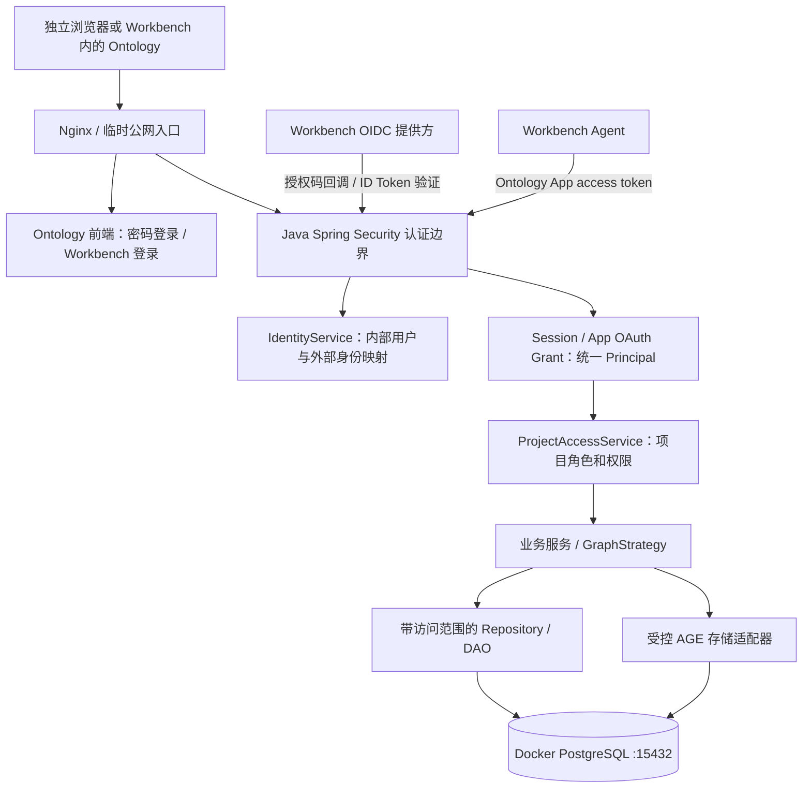

# Ontology 独立 App 多用户鉴权设计 v1.0

设计日期：2026-10-19。状态：已按逐项讨论更新产品规则，等待整体定稿，可据此拆分实施；本轮未修改业务源码、数据库、服务配置或 App 包。当前用户端 App 可打开是用户确认事实，不等于后端用户隔离已完成。

## 1. 核心决策

Ontology 拥有自己的用户、登录会话、项目成员和业务授权。账号密码与 Workbench OIDC 只是两种身份验证方式，最终都得到同一个内部 `user_id`。Java 后端是身份映射、会话验证和权限判断的唯一事实源；Nginx 负责入口和转发，Python 临时认证层在迁移完成后退出认证链路。

权限以现有“项目” `og_organization` 为边界：用户通过项目成员关系获得权限，项目中的图谱、节点、关系、导入导出与查询继承该权限。第一版支持“我的项目”和“与我共享”，不为每个人复制图库，也不把每条业务记录上的 `created_by` 当访问规则。

用户已确认第一版只做“用户 → 项目 → 图谱”的协作层级，不增加团队 / 组织层。这次目标是单个 Ontology 安装中的多用户与项目协作，不宣称实现企业租户隔离。Workbench 工作区不能未经验证直接等同 Ontology 项目。后续若需要独立企业租户，须单独建立租户及项目归属，并审计全部访问路径，不能只给 Token 增加 workspace 字段。

## 2. 已核实的现状

- Mac 上运行前端构建产物、Nginx `:18081`、Python `:18082`、Java `:13001`，通过原 Cloudflare 临时域名访问；四类进程当前均存在。
- Docker 容器 `ontology-local-postgres-1` 健康，绑定 `127.0.0.1:15432`；Java 外部配置指向 `ontology_workbench_local`。AGE 版本 1.6.0。
- 当前数据库有 1 个项目、2 个图谱、2 个本体节点、2 个实体节点，以及各 1 条本体关系和实体关系。没有孤立图谱。六张业务表没有内部用户、项目成员或 owner 字段。
- 数据库连接角色为 `mac`，具备超级用户权限。它不能作为多用户运行环境的最终最小权限角色。
- `5432` 当前没有监听；另一项目的 PostgreSQL `55432` 仍监听。本设计不修改这两个服务或其数据；未再次检查系统自动启动配置。
- Java 17 / Spring Boot 3.3.10 / MyBatis-Plus；未在现有源码中发现 Spring Security 过滤链或业务 Principal。框架依赖应使用与 Boot 版本兼容的一组版本，不能直接复制最新主版本文档的依赖号。
- 当前 Python 会话与 App OAuth grant 在内存中；后端并未读取其身份头来限制业务访问。当前项目列表是全局列表，详情与修改多按客户端传入 ID 查询。
- 前端 Login 仍为模拟登录，没有接真实登录接口；初始用户为静态资料，401 仅提示重新登录。需要正式路由、me 状态和 CSRF 集成，而不只是给现有按钮再加一个跳转。

[Workbench OIDC 公开 metadata](https://app.workbench.aos.work/.well-known/openid-configuration) 本轮再次查询成功：issuer 为 `https://app.workbench.aos.work`，支持授权码、S256 PKCE、`client_secret_post` 和 JWKS。之前用户已确认实际登录回到项目页。租户字段、账号停用通知、refresh grant、introspection、统一 logout 未在本次 discovery 中声明；“未声明”不等于平台绝对不支持。

## 3. 目标架构与模块职责

模块维持在现有 Java 应用中，无需先拆微服务或增加 Redis：

| 模块 | 职责 | 不承担的职责 |
| --- | --- | --- |
| security / authentication | 验密码、OIDC、Cookie、App Bearer；建立 Principal；CSRF | 不按任意请求头认定用户 |
| identity | 用户创建、禁用、身份绑定、密码管理 | 不根据邮箱自动合并账号 |
| access | 解析资源归属、项目成员权限、权限审计 | 不靠前端隐藏按钮保护数据 |
| project / graph 应用服务 | 在权限通过后执行业务，组织事务 | 不信任 body 中的 owner / user_id |
| DAO / repository | 对列表、详情和更新执行带范围查询 | 不先全量取数再内存过滤 |
| storage | 在已授权的图谱范围访问 AGE | 不接受任意图库名、SQL 或不受控 Cypher |
| Nginx | TLS 入口、静态资源、反代、大小和超时限制 | 不成为唯一授权点 |
| App 包 | iframe / website / OAuth / Agent 能力声明 | 不实现数据隔离，不持有用户密码 |

匿名可获取登录页、SPA 启动壳和必要静态资源，任何项目 / 图谱数据仍由受保护 API 提供。正式版本必须删除前端原固定 Cypher Key 及其构建产物中的副本，再开放登录所需的静态资源；不能沿用当前“所有静态资源先登录”的配置，否则密码登录页面无法启动。

即使绕过 Nginx 直接请求 Java，也必须验证凭证与业务权限。`X-Ontology-Subject`、`X-User-Id`、前端 JSON 的身份字段均不构成身份凭证。

## 4. 用户与两种登录

### 4.1 内部用户和账号绑定

内部用户编号由服务端生成并稳定关联；UUID 为候选方案，具体格式属于实施选型，不能将早期建议视为已经逐项批准。现有项目、图谱等业务大整数 ID 保持不变。统一 Principal 至少包含 `userId`、凭证类型、会话或授权标识、scope、用户状态和认证时间。项目角色与系统管理员全局权限实时从权限存储读取，不由前端或 Token 中的角色副本决定。

Workbench 身份键使用已验证的 `(issuer, subject)`，即 ID Token 的 `iss` 和 `sub`。昵称、username、邮箱仅为资料；它们不适合作为跨登录方式合并账号的依据。[OIDC 标准的身份稳定性说明](https://openid.net/specs/openid-connect-core-1_0.html#ClaimStability)

按用户已确认的方案，支持验证两种身份后主动绑定；两个入口不会天然对应同一个人：

- 已绑定的本地账号与 Workbench 身份必须返回同一 `user_id`。
- 首次 Workbench 登录只在准入策略允许时创建用户；不自动拥有旧项目。
- 合并已有本地账号必须在已登录且近期重新验证的会话中发起，再证明 Workbench 身份；唯一约束防止同一个外部身份绑定两个内部用户。
- 解绑或移除密码前必须保留至少一种可用登录方式。换绑、重设密码和恢复账号需要验证与审计，不接受前端提交“目标 user_id”完成绑定。

已确认关闭公开密码注册，以系统管理员邀请创建本地账号；受信 Workbench 身份首次验证成功后自动创建普通内部用户，用户建号不代表自动加入任何项目。T29 已确认通过本机受控初始化明确指定初始管理员，不将首个登录者自动提升。用户另明确当前本机测试超管为 admin，全部测试账号初始密码与各自用户名一致；按私有初始化输入处理，不作为公开 App 配置。T28 已确认本地账号激活及重置使用短期、单次专用链接，用户自行设密，服务端仅保存凭证摘要。初始化状态及测试账号清单见最新总稿，当前尚未实际建号。

### 4.2 账号密码登录

密码仅发给同源 Java HTTPS 登录接口，经 Spring Security 验证后建立 Ontology 会话。使用框架的 PasswordEncoder 和带盐自适应密码哈希，建议 Argon2id；参数经当前 Mac / 目标环境基准测试确定，支持编码版本升级。不得明文保存、可逆加密保存或把前端哈希当服务端密码保护。[Spring Security 密码存储](https://docs.spring.io/spring-security/reference/features/authentication/password-storage.html)

T23 已确认登录失败返回统一错误，避免暴露账号存在性；按账号与可信来源分别限制失败频率，使用短期冷却，不因匿名失败永久锁号或撤销正常会话。T28 已确认密码重置 / 账号激活凭证随机、单次、短期、用途绑定且服务端仅保存摘要；仅申请重置不更改原密码或踢掉会话，成功提交新密码时在事务内消费凭证。按 T21，修改或重置密码成功后撤销全部旧会话及 Agent 授权；用户禁用后两种登录均失效。

### 4.3 Workbench 登录

沿用已经跑通的 OIDC 授权码流程，不新猜 postMessage 或身份头协议：

1. Java 创建服务端 OIDC transaction，保存 state、nonce、PKCE verifier、受限成功跳转目标。
2. 顶层窗口进入 Workbench authorize，回调仍可保持公网 `/oidc/callback`。
3. Java 用原注册客户端在服务端交换授权码，验证 ID Token 签名、算法、issuer、audience / azp、有效期及 nonce。
4. IdentityService 通过唯一身份键解析或受控创建内部用户，确认其处于启用状态。
5. 轮换会话 ID，建立与密码登录相同的 Ontology 会话，再进入原前端。

依托 Spring Security OAuth2 Login 的协议能力；ID Token 只作为本次登录证明，不作为任意业务 API 的 Bearer。上游 Token 与 Secret 不给前端或 App 成员脚本。[Spring Security OAuth2 Login](https://docs.spring.io/spring-security/reference/servlet/oauth2/login/core.html)

OIDC discovery 缺少 UserInfo 声明时，应使用已验证 ID Token 的必要 claims，并显式适配该 provider；不能猜测 UserInfo URL，也不能因框架默认取资料失败而跳过 ID Token 校验。

## 5. 会话、浏览器与 Agent

### 5.1 浏览器会话

采用服务端不透明 Cookie 会话，由 Java 统一发行，使用 Spring Session JDBC 持久化到当前 PostgreSQL。Cookie：Secure、HttpOnly、Path=/、不配置 Domain。顶层浏览器推荐 Lax；需要 iframe 的部署可配置 SameSite=None，但必须配套 CSRF Token 与来源校验。OIDC 流程 Cookie 保持 Lax；SameSite 不能代替 state / nonce / PKCE。

同一个请求只选择一种身份：存在 Authorization 时严格验证 Bearer，无效即拒绝，不回退 Cookie；没有 Authorization 才检查 Cookie。不能把两个凭证的身份或权限合并。

T08 已确认默认闲置 30 分钟、绝对 8 小时；T09 用户选择 A，确认自动续期保留该上限，不增加跨天持久登录。有效使用请求滚动延长闲置期限，纯后台刷新不抵消闲置限制；上游 API 凭证的自动刷新仅在确有调用需求且平台支持时接入。ID Token 的 exp 用于登录时验证身份凭证能否被接受，不直接决定登录后 Ontology 会话的寿命；Workbench 与 Ontology 分别管理自己的会话。Ontology 会话到期后重新走 OIDC，不依赖未确认的上游刷新能力。纯后台轮询 / 保活不应无限延长闲置期限，实施时明确有效使用请求与后台请求的分类；页面到期前提示，不能将仅本地编辑等同于服务端已收到使用请求。浏览器会话、权限和账号状态由服务端判定，页面不能依赖 localStorage 中的“已登录”标志。[联合登录中的会话独立性](https://pages.nist.gov/800-63-4/sp800-63c.html)

每次恢复 JDBC 会话都要检查内部用户状态与 auth_version；不是从数据库读回旧 SecurityContext 就永久信任其状态。用户禁用 / 安全版本变化会使现存会话失效；DB 或授权状态读取失败时拒绝请求，不能回退到前端标志或旧 Nginx 身份头。

Cookie 认证下的 POST / PUT / DELETE 等操作，即使业务语义为读取，也按 HTTP 方法执行 CSRF 校验。前端从同源接口获取 CSRF Token 并带入请求，同时检查 Origin；不能靠给请求加任意身份 Header绕过。

T21 已确认普通退出仅撤销当前浏览器会话，不撤销尚有效的独立 Agent 授权；取消指定 App 连接时撤销对应授权及访问/刷新令牌。退出全部设备、修改或重置密码、禁用账号等账号级事件更新安全版本，撤销全部旧会话及 Agent 授权。重新启用账号不复活旧凭证。撤销与刷新协调并发，后续请求检查当前状态；Workbench 端断开连接是否联动本服务撤销接口须实测。身份换绑等其他安全事件的具体影响仍按后续设计落实；Workbench 单点注销、账号停用同步只有拿到正式契约后才接入，不声称退出 Ontology 会同时退出 Workbench。

### 5.2 Workbench App / Agent 凭证

保留两段授权：Workbench 是网页登录的上游 OIDC provider；Ontology 是 Agent 访问本应用 API 的 OAuth2 provider。第二段也迁入 Java，由成熟 OAuth2 组件处理授权码和 PKCE、由同一 IdentityService / Principal 解析用户，不再另建 Python 用户表或会话。

T25 已确认采用 Spring 官方授权服务器能力（Spring Authorization Server / 对应 Spring Security 授权服务器模块），集成于同一 Java 应用，持久化注册客户端、授权码和 access grants；具体依赖组合经维护状态及现有依赖兼容性验证后锁定，大版本升级单列评估。复用协议库不等于默认持久化已经符合已确认的 Token 摘要要求，需要对存储适配、刷新及撤销策略进行明确实现和验收。[Spring 官方授权服务器组件](https://docs.spring.io/spring-security/reference/servlet/oauth2/authorization-server/core-model-components.html)

App 授权须显示当前 Ontology 账号和授权范围，支持切换账号，不能在共享浏览器中无提示沿用上一个人的身份。T19 已确认访问令牌使用不透明随机值，绑定内部 `user_id`、client、scope、有效期和撤销状态；服务端仅持久化令牌摘要及授权记录，不在日志、URL或成员文件保存原值。OAuth2 组件的默认持久化需按此适配并验收。

T20 已确认 App access token 单张最长 15 分钟，通过随机刷新令牌轮换自动续期；同一授权固定在其依据的本次 Ontology 登录验证时间后最多 8 小时截止，刷新不得延长整体截止，新访问令牌也不得超出截止时间。刷新验证客户端绑定、scope、账号安全版本及授权状态，刷新令牌仅保存摘要；实现重用检测、关联授权组撤销、并发和重试控制。Calendar/Base/Library 正式清单均声明 refreshUrl，但 Workbench 实际轮换处理仍需联调验证。实施并通过验收后才在新 Manifest 启用刷新能力；普通网页登录退出与 Agent 授权的联动范围按已确认 T21 执行。

T18 已确认 scope 区分 `profile`、`ontology.read`、`ontology.write`、`ontology.manage`，由 Java 同时检查 App 授权范围与当前项目角色。旧包只有 profile，不能默认为它赋予所有写入权限；切换正式权限版需要升包并重新授权。Agent / API Bearer 的实际范围为：

`用户启用状态 ∩ （当前项目成员权限或系统管理员全局权限） ∩ App scope ∩ 有效且未撤销的 grant`

浏览器 Cookie 的实际范围为：

`用户启用状态 ∩ 有效且未撤销的 session ∩ （当前项目成员权限或系统管理员全局权限）`

浏览器不要求 App OAuth scope / grant，但写请求仍执行 CSRF 和来源检查。Bearer 的路由 / Action 能力映射如下，由 Java 安全边界和应用服务共同执行，不能只写在成员 Skill 中：

| App scope | API / Action 类别 | 额外业务能力 |
| --- | --- | --- |
| profile | userinfo / getCurrentUser / identity | 当前内部用户身份有效，不授予业务访问 |
| ontology.read | 项目 / 图谱 / 节点 / 关系列表、详情、可选项、受控 preview | PROJECT_READ / GRAPH_READ |
| ontology.read | exportGraph | 另需项目 EXPORT 权限，VIEWER 也具备 |
| ontology.write | 新增 / 编辑图谱、维护节点与关系和 importGraph | 相应项目写权限，导入额外检查 IMPORT |
| ontology.write | deleteGraph | 另需 GRAPH_DELETE，仅 OWNER / ADMIN 或系统管理员具备，EDITOR 不具备 |
| ontology.write | 创建项目、编辑项目资料 | 创建默认允许启用用户；编辑需 PROJECT_EDIT |
| ontology.manage | 成员 / 邀请管理、owner 转移、项目删除 | 对应 ADMIN / OWNER 能力，不能凭 scope 提升项目角色 |

read/write/manage 互不隐式替代，授权包需要请求其实际要用的组合；profile-only 的旧授权只能调用身份接口。

有效 scope 不赋予用户原本没有的项目访问权；系统管理员可依据已确认的全局权限访问所有项目。普通成员已被移除且无其他授权时，即使旧 access token 未到期，新请求也必须拒绝；系统管理员是否仍可访问由其当前全局权限决定。按用户已确认的方案，Agent 可在当前用户的项目权限范围内新增、修改及删除数据，写入前必须先取得用户对具体目标与变更范围的确认；查看者仍只读并可导出。Agent 的 `_confirm=true` 只是交互确认，不是后端授权凭证。

### 5.3 iframe 和跨域

保留 0.1.1 的 `hasIframe / iframeUrl / websiteUrl / entryPath` 页面承载声明。登录与授权在顶层窗口完成；嵌入页显示进入 / 重试 / 新窗口按钮。

第三方 Cookie 被浏览器禁止时，即使 SameSite=None 也不能保证 iframe 获得会话。按用户已确认的方案，首版允许新窗口完成登录，并明确支持在浏览器限制内嵌会话时通过新窗口独立使用；如产品要求无第三方 Cookie 也能在 iframe 无缝使用，须另行验证平台与浏览器支持的受控会话引导协议，不能用 URL Token、任意来源 postMessage 或关闭校验凑通。

前端与 API 保持同一 Ontology origin。iframe 的父页面在 Workbench 不意味着 API 必须开放通配 CORS。移除现有凭证 + 任意 origin 组合，仅允许确有必要的精确 origin；CSP frame-ancestors 限制为自身与已确认 Workbench 宿主。

## 6. 项目权限模型

`og_organization` 在领域上明确叫“项目 Project”，保留现有表名和 API 以减少迁移风险。默认已启用用户可以创建自己的项目；新增项目时由当前 Principal 创建 OWNER 成员记录；`created_by` 只作为审计信息，真正访问权只由成员记录决定。

| 操作 | OWNER | ADMIN | EDITOR | VIEWER |
| --- | --- | --- | --- | --- |
| 查看项目、图谱、节点、关系、受控预览 | 是 | 是 | 是 | 是 |
| 新建 / 修改图谱，维护节点与关系 | 是 | 是 | 是 | 否 |
| 删除整张图谱 | 是 | 是 | 否 | 否 |
| 导入业务图数据 | 是 | 是 | 是 | 否 |
| 导出有权访问的业务图数据 | 是 | 是 | 是 | 是 |
| 修改项目资料、邀请 EDITOR / VIEWER、移除普通成员 | 是 | 是 | 否 | 否 |
| 任免 ADMIN、转移项目所有权、删除项目 | 是 | 否 | 否 | 否 |
| 执行任意 SQL / 自由 Cypher / 数据库管理 | 否 | 否 | 否 | 否 |

按用户已确认的规则，成员退出或被移除后撤销其项目成员访问权限，其创建的图谱、节点与关系继续归项目保留，不执行按 created_by 级联删除；剩余成员按权限维护。若该用户同时为系统管理员，其独立全局权限仍按已确认规则生效。

第一版每个 ACTIVE 项目恰有一个 OWNER；迁移中的 UNASSIGNED 项目是受隔离的例外，普通业务用户不可见。这一事实保存在成员表中，项目表不再增加第二份可独立修改的 owner 字段。转移所有权在锁定项目后的单个事务中升降双方角色；不能删除最后一个 OWNER，OWNER 也不能直接退出。管理员不能提升自己为 OWNER 或移除 OWNER。

系统管理员与项目管理员分开。按用户已确认的结论，系统管理员默认可查看和管理所有项目；这是服务端赋予的全局业务权限，不能由前端字段、身份头或普通项目 ADMIN 角色获得。ProjectAccessService 显式判断该权限并记录跨项目敏感操作审计；App Bearer 仍受 scope 和 grant 有效性约束。该全局权限不等同数据库超级用户、自由 SQL/Cypher 执行权或免审计。项目 OWNER 仍保留明确归属，系统管理员执行所有权调整需遵守单一 OWNER 及事务完整性规则。

邀请携带单次短期随机凭证及目标项目 / 角色，接受时绑定已验证的当前用户；能绑定到内部用户时优先按内部用户邀请。邮箱邀请只作为受控交付流程，不能凭客户端填写的邮箱认领成员身份。

## 7. 业务访问必须覆盖的边界

### 7.1 列表、详情、修改和跨资源引用

- 项目分页 SQL 通过 `project_member.user_id=currentPrincipal.userId` 过滤，再分页和计算 total；统计与图谱数量也只计算可见范围。
- 图谱操作先通过持久化 graph 解析所属项目，再判断能力；`graphType` 和组织归属来自已查到的记录，不用前端值选择另一套表。
- 节点 / 关系先解析真实 graph_id，校验其与请求 graphId 一致，再继承图谱权限。关系两端必须属于正确的同一图谱；不能以“允许的 graphId + 别人的 nodeId”完成写入。
- 实体图谱关联的本体图谱、实体节点关联的本体节点、实体关系关联的本体关系，均校验父图谱及项目一致性。首版禁止跨项目复用本体；未来共享模型需独立能力契约。
- 批量请求中混入任何无权限 ID，应整批拒绝并回滚，不静默删除 / 忽略越权项后返回成功。
- 修改普通 graph DTO 不允许移动项目；项目转移若后续开放，应提供单独受权操作，并校验源 / 目标两个范围。
- 导出同样鉴权；导入只接受业务字段，拒绝系统归属 / 权限字段。新资源生成新 ID 并重建引用映射，不允许上传文件覆盖别人的 ID、owner 或成员。

服务层调用 `ProjectAccessService` / `AuthorizedResourceResolver` 产生已授权资源上下文，存储适配器只接收此上下文。DAO 查询 / 更新带上已确认的资源归属条件，并校验影响行数，禁止向 Controller 塞一批散落的 if。现有实体 ActiveRecord 的 save/update 也必须逐条迁入受控写路径，不能只修改 DAO 列表就保留按任意 ID 的旧写入口。事务中再次读取当前授权关系，成员角色变更与敏感写操作按项目锁顺序协调。

越权读取统一按“资源不存在或不可访问”返回 404；已可见资源上的能力不足返回 403；缺失 / 过期身份返回 401。真实 HTTP 状态与业务错误码一致，不将认证失败包装为 HTTP 200。拒绝响应不泄露其他项目名称、数量或内部存储错误。

### 7.2 AGE、Cypher 与数据库权限

用户在 T14 明确要求保留 Cypher 语句输入框：在哪个图谱输入，就限定在哪个图谱执行。撤回此前“首版停用自由查询并用固定查询类型替代”的建议。T15 用户确认该输入框仅用于只读查询；所有应用角色在此入口均不取得语句写入能力，增删改通过业务功能按角色授权，不得将保留输入功能解释为允许任意数据库执行。

原 `/cypher/query` 当前通过字符串拼接构造 AGE SQL。仅在 Controller 检查 graphId，并不能证明任意文本无法跨图库或越过 SQL 边界；本轮未执行攻击性验证。保留界面交互的同时，执行层需要实现并验证当前图谱限定、项目授权、SQL/Cypher 文本边界及执行权限。具体技术机制尚待设计验证，不能沿用旧拼接方式就宣称完成隔离；预览及 Agent 调用也遵守同一边界。

AGE 图库名称从持久化图谱的真实类型与 ID 生成，不接收客户端传入图库 / schema 名。业务参数、动态标识符与可执行语句分开处理；不能用删关键词、正则排除 DELETE、拼 WHERE 或单纯 LIMIT 假装隔离。具体方案须通过跨图库、越权写入及输入边界测试，并设置执行超时及结果规模限制。按 T15，只读须由实际执行权限及可验证的语句边界落实，不能仅配置框架只读提示就视为完成；具体 AGE 兼容机制待实现验证。

按已确认的讨论结论，VIEWER 可以导出其可访问的图谱数据；导出接口仍校验项目访问范围，不能扩大资源可见性。

迁移角色只用于扩展 / DDL；Java 普通运行角色不得为 superuser、BYPASSRLS 或随意切换角色。AGE 的图创建、schema 权限与连接初始化必须先做最小权限验证；不能遇到 AGE 权限问题就把全部 API 恢复为超级用户。

业务表可在应用层权限全面覆盖后增加 PostgreSQL RLS 作为纵深防御，但它不替代 Java 业务授权、也不会自动保护 AGE 动态 SQL。superuser / BYPASSRLS 会绕过 RLS，当前角色不适合直接声称具备行隔离。[PostgreSQL 行安全说明](https://www.postgresql.org/docs/current/ddl-rowsecurity.html)

### 7.3 事务、缓存与审计

拒绝的请求不能对业务表或 AGE 产生副作用；成功写入遵守当前业务 Schema 校验和事务。当前 PostgreSQL / AGE 同库仍需验证 MyBatis 与 JDBC 使用同一事务连接；后续如果切换 Neo4j，要另评估跨存储一致性。

首版不缓存权限结论；必要缓存必须含 user_id / project_id / 权限版本，并明确撤销失效机制。撤销提交后的新事务不再允许旧权限；已在途请求按事务边界处理，长查询取消需额外机制，不能宣称全局瞬间终止。

审计记录 actor_user_id、认证来源、client_id、项目 / 资源 ID、操作、时间、结果和 request_id；不记录密码、Cookie、完整 Token、授权码或敏感业务正文。业务管理员不能修改安全审计。

## 8. 数据模型与约束

以下为拟新增模型，不是已经执行的 DDL：

| 模型 | 核心字段 / 约束 |
| --- | --- |
| og_user | UUID id、display_name、status、auth_version、timestamps；无明文密码 |
| og_local_credential | user_id 唯一外键、normalized_username 唯一、password_hash、password_changed_at |
| og_user_identity | user_id、provider_key、issuer、subject、受控资料；唯一 (issuer, subject) |
| Spring Session JDBC 表 | 框架管理持久化浏览器会话；关联内部用户，配置 idle / absolute expiry 与撤销策略 |
| og_project_member | project_id、user_id、role、status、granted_by；唯一 (project_id,user_id)，每项目至多一个 ACTIVE OWNER，事务保证至少一个 |
| og_project_invitation | project_id、角色、目标用户或受控邀请目标、token_hash、expires_at、used_at、inviter |
| OAuth 注册客户端 / authorization / grant 存储 | client、授权码、内部 user_id、scope、到期、撤销、auth_version；凭证存储经审查，不直接照搬临时 Python 内存字典 |
| og_audit_event | 不可由业务角色修改的认证、授权与敏感操作记录 |
| og_organization 增量状态 | access_state：UNASSIGNED / ACTIVE / ARCHIVED；可选 version 用于并发控制；ACTIVE 与 OWNER 成员在同一事务建立 |
| 原业务表增量字段 / 约束 | created_by / updated_by 用于审计；图谱→项目、节点→图谱、关系→端点等外键与索引经存量校验后添加 |

不要给每个下级对象独立增加一份可写 owner，造成项目所有者和节点所有者相互矛盾。项目 ACL 为权限唯一事实源；内部 user_id 与外部 Workbench sub 也不能混为同一个字段。

关键索引包括成员 `(user_id,status,project_id)`、`(project_id,user_id)`、图谱 `(organization_id,type,update_time,id)`、节点 / 关系 `(graph_id,id)`、identity 唯一键和 grants 到期 / 撤销查询。认证、邀请、会话和 grant 的时间字段使用带时区类型与统一时钟；到期判断不由前端本地时间决定。数据完整性约束不替代“调用者是否有权限”。

## 9. 接口与兼容性草案

登录页及其静态资源可匿名访问；auth/csrf 与登录发起有明确限流 / CSRF 策略；me、身份绑定与退出均依赖已验证会话。OIDC / OAuth 的协议端点分别验证 transaction 或客户端，不等同于将全部 `/auth/**`、`/oidc/**` 的操作无条件放行。其余数据 API 默认要求认证与业务权限。

实际 HTTP 路径受 Java `/api/v1` context-path 与 Nginx 代理影响；下面给出对外契约，实施时明确映射，不误把内部 Controller 相对路径当公网路径：

| 对外路径 | 用途 |
| --- | --- |
| GET /api/v1/auth/me | 当前内部用户、可用登录方式与会话状态；不接受 userId 选用户 |
| GET /api/v1/auth/csrf | 获取会话绑定的 CSRF Token |
| POST /api/v1/auth/login | 本地密码登录，轮换会话 |
| GET /oidc/login / GET /oidc/callback | Workbench OIDC，保留现有注册地址与入口 |
| POST /api/v1/auth/logout、/logout-all | 撤销当前 / 全部本地会话与明确范围的 grants |
| POST /api/v1/auth/identities/workbench/link | 近期重认证后发起身份绑定，走独立 OIDC transaction |
| 项目成员 / 邀请 / transfer-owner 子资源 | 项目成员管理，独立能力校验，不能混进普通 edit DTO |
| /oidc/app/authorize、/token、/userinfo | Java 接管既有 App OAuth 路径；固定 Workbench callback |
| GET /oidc/embed | 嵌入接入页与顶层登录入口 |
| 新受控 preview / 结构化查询接口 | 替代普通用户自由 Cypher |

业务 DTO 不新增可用于“选身份”的 userId 参数。客户端可以提交项目或资源 ID 作为业务目标，但 Java 必须从真实资源关系核对该目标。

新 App userinfo 的 `id` 改为 Ontology 内部 user_id；上游 sub 仅在身份映射中保留。已有 App 账号绑定的稳定 ID 发生变化，迁移时必须发布新版并要求重新连接，不能静默把旧绑定当作已完成内部用户映射。App 客户端 Secret 保留管理端配置边界，上游 OIDC Secret 仍只留服务端。

### 9.1 前端调整位置

保留原图谱编辑业务界面，补正式 `/login` 路由及双入口。启动时调用 `auth/me`，前端状态只展示服务端结果；401 清理页面身份并引导登录，403 / 404 展示无权限或不可访问，API 不跟随跳转去拿登录 HTML。前端添加 CSRF 获取与请求头，并增加账号绑定、设备退出、项目成员管理界面。

前端按服务端返回的能力控制按钮用于交互，但手写 HTTP 请求仍由 Java 拒绝。登录表单不得 console.log 密码；业务深链回跳必须在同源且已授权的路径范围，不能从 query 任意取外部 returnUrl。App 成员仍从宿主 env 获取 Bearer，不与浏览器共享 Cookie 或把 Token 发给 iframe JS。

## 10. 存量数据迁移与切换

现有 1 个项目和 2 个图谱没有用户归属。不能“第一个登录的人自动成为旧数据 owner”，也不能给所有新用户默认可读。

T24 已确认保留数据的增量迁移及统一切换策略，结合已确认的存量归属规则，拟按以下步骤实施（尚未执行）：

1. 在维护窗口之前备份整个数据库（包含 AGE 图 schema、ag_catalog 和业务 schema）及必要角色信息，验证在临时数据库恢复后对象数量与查询一致；现有 dump 文件存在不等于本轮恢复演练已通过。
2. 新增版本化 Flyway migration，创建身份 / 成员 / grants 等结构；原 `V0.0.1__init_database.sql` 含 DROP TABLE，不改写或重跑它。当前已应用版本为 0.0.1，新增版本号在实施分支中确定。
3. 核对图谱与节点 / 关系的父子关系、重复 ID / 唯一约束与缺失引用；对现有数据形成迁移清单。
4. 保留资源 ID 和 AGE 图名称；历史 created_by 无证据时保持空值并记录迁移来源，不把新分配 owner 伪称为历史创建者。按用户已确认的方案，在同一事务中将存量项目的 OWNER 分配给明确指定的初始系统管理员并设为 ACTIVE，再由其转交具体负责人。不得将第一个登录的人自动设为 owner。若指定管理员未初始化或分配失败，则保持 UNASSIGNED，普通用户不可见，迁移验收不予通过。
5. 创建受限运行 DB 角色并验证 AGE 读写与图谱创建；DDL / 扩展维护使用独立迁移角色。
6. 在测试环境完成 Java 全部身份、ACL 与 Agent 验收后，统一切换 `/oidc/*`、业务 API 与会话检查到 Java。停止旧 Python 授权发行，所有旧 Python Cookie / access token 失效，用户重新登录与连接 App。
7. 关闭 Nginx 的旧静态 Key 注入与“身份头即可信”的逻辑。登录页 / SPA 静态启动资源按前述规则开放，数据只从 Java 受保护 API 取得；确有敏感下载等保护资源时可调用 Java auth_request，但 Java 自身仍独立验证 API 和业务权限；禁止双栈任一验证通过即放行。
8. 发布匹配新版协议的前端与 App 包，更新已安装版本；验证后才解除维护入口。

数据库迁移必须可对账：项目 / 图谱 / 节点 / 关系数量与 ID 保持，授权成员与归属清单吻合，未分配项目保持不可见。维护期间不接受新业务写入，避免备份和迁移之间丢数据。

回滚以验证过的数据库备份和匹配版本构建为单位；若权限版已产生业务写入，不能盲目恢复旧 dump 覆盖新数据，应停止写入并执行经审计的修复。绝不能为了恢复可用性把多用户数据重新暴露给旧的无权限后端。

## 11. 实施拆分与验收门槛

| 阶段 | 修改重点 | 验收完成的标志 |
| --- | --- | --- |
| A：身份基础 | Java Security、内部用户 / 身份、密码、OIDC、JDBC 会话、CSRF、me/logout、撤销 | 双入口同一绑定用户返回同一个内部 user_id；伪造头、过期 / 禁用身份被拒绝 |
| B：项目与资源权限 | 成员 / 角色、带范围 DAO、GraphStrategy、引用校验、导入导出、受控查询、DB 角色、迁移 | 两个无共享项目的用户无法互相访问任何业务路径，拒绝无副作用 |
| C：前端与 App | 双入口真实登录、路由状态、成员界面、401/403、iframe、Java App OAuth 与 scope | 页面与 Agent 使用同一用户和 ACL；资源授权、续期策略和重连行为可验证 |
| D：存量与切换 | 全库恢复演练、旧项目归属、原子切换、停旧 Python、回归与审计 | 旧资源不丢失、不默认公开、旧 Token 不能通行，当前 App 与独立浏览器均可使用 |

A 阶段完成时仍不能将环境当成多用户应用对外开放；必须至少通过 B 并完成所需迁移。测试在复制的数据库 / 专用测试项目中执行，不能拿其他项目的 55432 实例做实验。

必须覆盖的自动化 / 集成验收：

- 本地密码与绑定 Workbench 身份返回同一 user_id；同邮箱但未绑定的两人不会自动合并。
- 未登录直接请求 Java 为 401；伪造 Nginx 身份头 / body.user_id / graphType 不改变身份或访问范围。
- 用户 A 与 B 的项目列表、total、统计、详情、节点 / 关系可选项、导入导出和预览完全隔离；同名项目也不串数据。
- VIEWER 可读及导出但不可写；EDITOR 不能删除整张图谱、邀请或转移所有权；ADMIN 不能提升自己或移除 OWNER；最后一个 OWNER 不能退出。
- 替换 graphId / nodeId / relationshipId、混合批量 ID、跨项目本体引用、上传越权归属与转移目标均拒绝，业务表和 AGE 不变。
- 有效 Agent token + 无项目权限仍拒绝；read scope 不能写；普通成员被移除且无其他授权时旧 Token 不再访问该项目；系统管理员全局权限被撤销后回到其普通项目权限；账号禁用 / grant 撤销后，旧 Token 对新请求失效。
- Cookie 缺 CSRF、错误 Origin 被拒绝；合法同源请求成功；Bearer 不依赖浏览器 Cookie；无第三方 Cookie 时不循环跳转。
- OIDC 错 state / nonce / iss / aud / 签名 / 过期 / 授权码重放失败；失败不会创建有效会话或绑定外部身份。
- 重启 Java 后持久化会话遵守既定策略；退出、改密、禁用与权限撤销有审计且不泄露凭证。
- 受控查询不能跨 AGE 图，无法通过 SQL / Cypher 文本取得其他项目或任意写权限；只读查询有超时与结果上限。
- 数据恢复演练与存量归属对账通过；业务大整数 ID 不经浮点变换；启动不重跑旧 DROP 初始化。

## 12. 讨论后的确认状态

产品规则已经逐项确认，汇总见[多用户方案确认稿 v1.1](Ontology-多用户方案确认稿-v1.1.md)，原始讨论见[方案讨论记录](方案讨论记录.md)。若本技术稿中的早期建议与已确认产品规则存在冲突，以确认稿及后续用户指令为准。

实施准备仍需确定初始系统管理员的具体账号、服务端密钥配置与构建版本。这些不是重新讨论产品权限；不得把第一个登录用户当作初始管理员。Workbench 续期、统一注销和工作区的未确认契约不作为首版已实现能力。

## 13. 关键源码证据

- [项目分页没有用户范围](/Users/mac/项目/意谱科技/ontology插件/ontology-server-master-10865b72641fdba0f6d0e062df43451d197b1dc4/ontology-core/src/main/java/com/devin/ontology/dao/OrganizationDao.java:46)。
- [项目创建与修改直接使用 DTO](/Users/mac/项目/意谱科技/ontology插件/ontology-server-master-10865b72641fdba0f6d0e062df43451d197b1dc4/ontology-core/src/main/java/com/devin/ontology/service/impl/OrganizationServiceImpl.java:51)。
- [图谱创建 / 修改与关联项目处理](/Users/mac/项目/意谱科技/ontology插件/ontology-server-master-10865b72641fdba0f6d0e062df43451d197b1dc4/ontology-core/src/main/java/com/devin/ontology/strategy/graph/GraphStrategyAbstract.java:86)。
- [图谱详情与导入导出入口](/Users/mac/项目/意谱科技/ontology插件/ontology-server-master-10865b72641fdba0f6d0e062df43451d197b1dc4/ontology-core/src/main/java/com/devin/ontology/strategy/graph/GraphStrategyAbstract.java:272)。
- [自由查询 Controller 按图谱 ID 取记录](/Users/mac/项目/意谱科技/ontology插件/ontology-server-master-10865b72641fdba0f6d0e062df43451d197b1dc4/ontology-core/src/main/java/com/devin/ontology/controller/CypherController.java:53)。
- [AGE 查询将 Cypher 拼入 SQL](/Users/mac/项目/意谱科技/ontology插件/ontology-server-master-10865b72641fdba0f6d0e062df43451d197b1dc4/ontology-core/src/main/java/com/devin/ontology/strategy/storage/impl/AgeStrategy.java:775)。
- [当前 CORS 为允许凭证与任意 origin](/Users/mac/项目/意谱科技/ontology插件/ontology-server-master-10865b72641fdba0f6d0e062df43451d197b1dc4/ontology-common/src/main/java/com/devin/ontology/common/configuration/MvcConfiguration.java:30)。
- [旧初始化 migration 含 DROP TABLE](/Users/mac/项目/意谱科技/ontology插件/ontology-server-master-10865b72641fdba0f6d0e062df43451d197b1dc4/ontology-core/src/main/resources/flyway/V0.0.1__init_database.sql:1)。

- [前端模拟登录，提交仅提示成功](/Users/mac/项目/意谱科技/ontology插件/ontology-frontend/src/pages/Login/index.tsx:9)。
- [前端静态初始用户、401 提示和请求配置](/Users/mac/项目/意谱科技/ontology插件/ontology-frontend/src/app.tsx:20)。
- [当前业务路由与登录路由缺口](/Users/mac/项目/意谱科技/ontology插件/ontology-frontend/src/config/routes.ts:3)。
- [当前 App 仅 profile scope 与 Bearer 声明](/Users/mac/项目/意谱科技/插件开发/02-App应用/03-我的开发/Ontology/03-接入包/0.1.1/source/manifest.yaml:17)。
- [当前 broker 的 userinfo.id 来自上游 subject](/Users/mac/项目/意谱科技/插件开发/02-App应用/03-我的开发/Ontology/04-测试与交付/本地运行/oidc_gateway/app_oauth.py:286)。

证据局限：本轮只读核对源码、容器 / 端口、数据库 schema / 数量 / 角色和公开 metadata；没有实施上述认证与权限改造，没有登录攻击测试、没有恢复演练，也没有以新权限模型完成真实用户验收。
